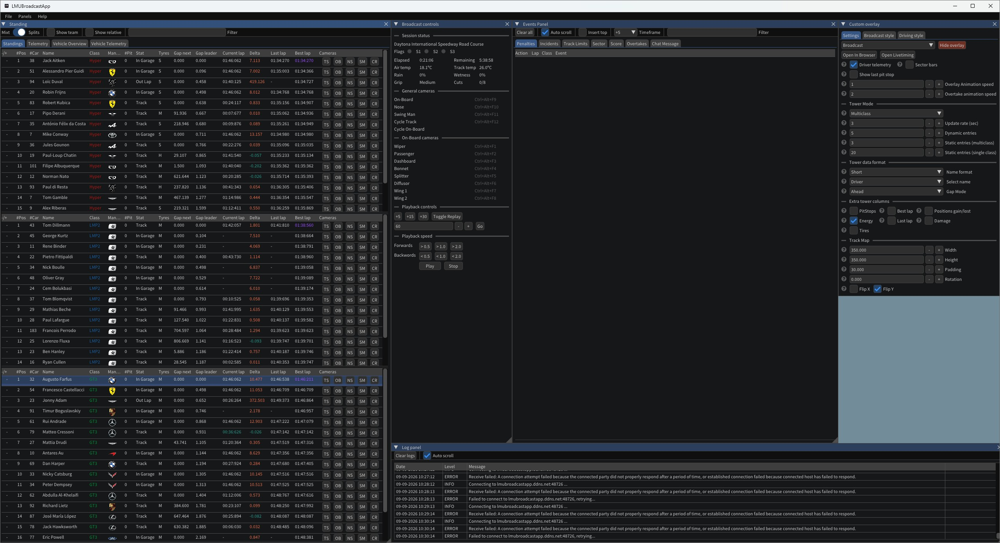
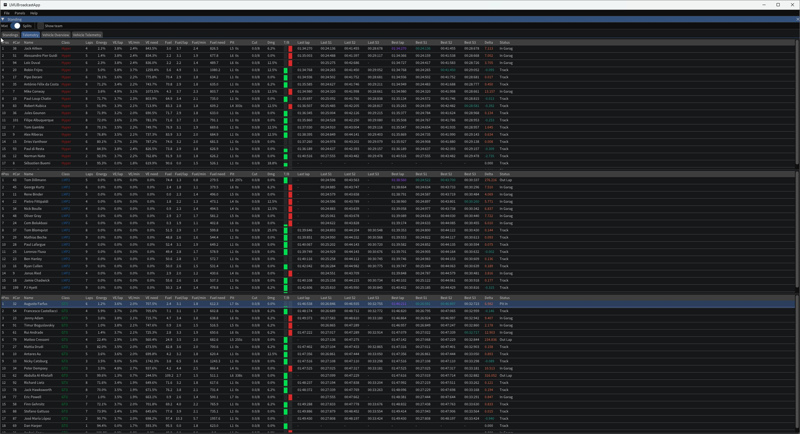
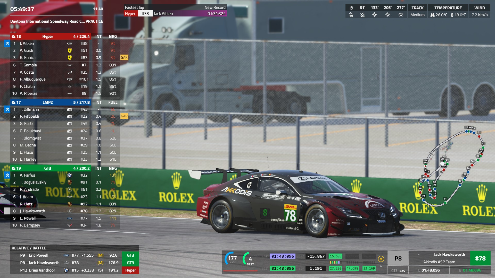
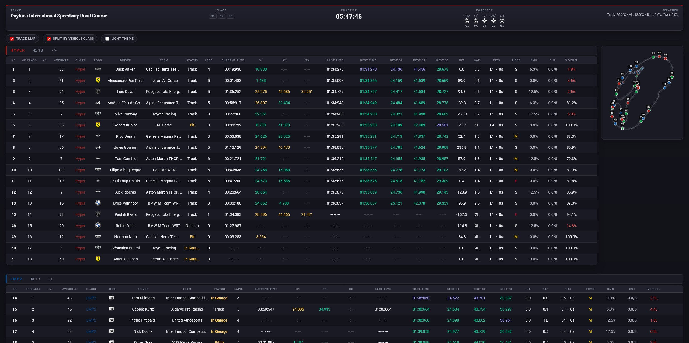
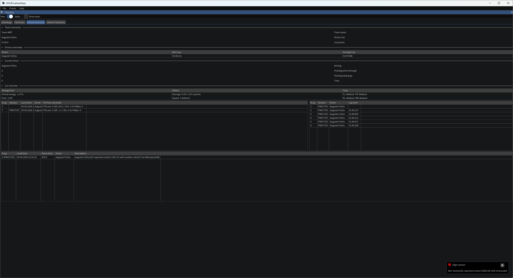
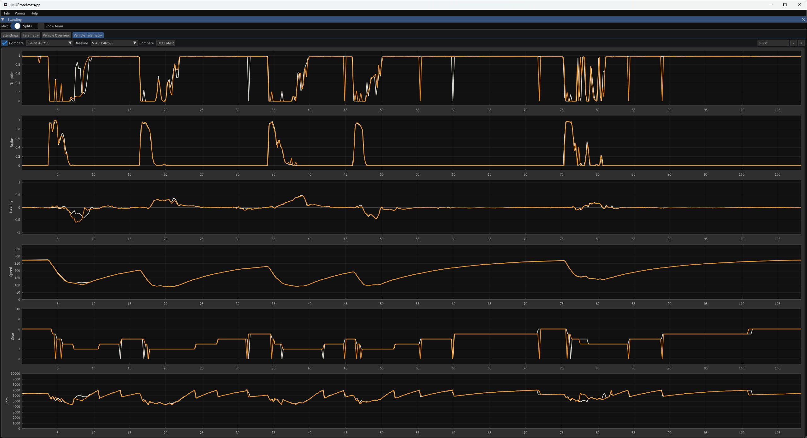

### 🚀 LMUBroadcastApp
<p>
    
    An intuitive broadcast application that allows a small production team (or even a single operator) to manage a live stream and replays, view track events, handle cameras, etc. — enhancing the storytelling of the race.
</p>

<p>
    
</p>

---

### 🎬 Overview
The program offers a simple way to switch between cameras and access the various events that can occur during the race: penalties, incidents, track limits, etc.
Below is a description of the different panels within the application:

- 📊 **Standings**: Live on-track and class position, car number, driver/team, vehicle logo, status, sectors, laps, gaps, track cuts and telemetry columns. Focus any car with a click and split the table by class or switch to a relative view.
- 🎮 **Broadcast controls**: General and on-board cameras, plus a session status block (track, elapsed/remaining time, temperatures, rain, grip and track cuts).
- 🎨 **Custom overlays**: Show the broadcast or driving overlay over the game, open it in a browser or OBS, open livetiming, and configure every panel (position, colours, typography, tower columns, map transform, starting grid and live classification).
- 🎥 **AutoCam**: Let the system pick the most interesting car on track based on battles, overtakes, incidents, pit activity, freshness and behaviour unpredictability.
- 🎥 **Events panel**: Penalties, incidents, track limits, sector events, score changes, overtakes and chat messages, with filtering, timeframe and auto-scroll.
- 🚗 **Vehicle overview & telemetry**: Per-team and per-driver overviews, pit-stop log, lap history, throttle/brake/steering traces, lap comparison, track map and suspension plots.
- ⚠️ **Logger & Profiling**: Built-in logging and a performance panel for debugging and monitoring.

---

### ✨ Highlights
- **Replay control** — toggle replay, jump back 5/15/30 seconds or a custom amount, and change playback speed forward or backward.
- **Fullscreen overlays** — a paged starting grid from the qualifying order and a class-grouped live classification take over the whole window while active.
- **Notifications** — race winner, fastest lap, penalties, track limits, incidents and possible best lap, with configurable position and contact-point severity.
- **Customisation** — dark/light mode, Default/LBA/Adobe Spectrum themes, five presets, live key capture and an adjustable overlay animation speed.
- **Local servers** — the app serves the overlay on HTTP `6432` and pushes live data on WebSocket `6433`; both ports and the game endpoint are configurable.
- **Bring your own overlay** — point the Assets directory at a folder of overlay files to replace the built-in pages, no rebuild required.

---

### 📥 Download
👉 Download the latest version:<br/>
https://github.com/LmuBroadcastApp/LMUBroadcastApp/releases/latest/download/LMUBroadcastApp.zip

📦 All releases:<br/>
https://github.com/LmuBroadcastApp/LMUBroadcastApp/releases

---

### ⚙️ Installation
1. Download the latest release from the link above
2. Extract the archive
3. Run the executable file
4. Launch the app after the game session is fully loaded

**Requirements**
- Windows 10/11 (64-bit)
- Le Mans Ultimate running on the same machine
- Microsoft Edge WebView2 Runtime (for the overlay window)
- A valid license for the premium features

### 🗂️ Configuration
Everything is stored next to the executable:

| Path | Contents |
|------|----------|
| `config/config.json` | Application settings, panel state and overlay layout |
| `config/keybindings.json` | Global hotkeys |
| `config/license.xml` | License data |
| `config/log.txt` | Application log |
| `presets/preset_1.json` … `preset_5.json` | Saved presets |

The overlay pages can be previewed in any browser while the app is running:

```text
http://localhost:6432/broadcasting/index.html
http://localhost:6432/driving/index.html
http://localhost:6432/livetiming/index.html
```

---

### 🛠️ Issues & Contributions
Have a bug report, feature request, or idea? <br/>
👉 Open an issue: https://github.com/LmuBroadcastApp/LMUBroadcastApp/issues

---

### 📚 Wiki
* 📊 [Standings & Panels](wiki/standings.md)
* 🎥 [Replay & Broadcast Controls](wiki/replay-controls.md)
* 🚗 [Vehicle Overview & Telemetry](wiki/vehicle-telemetry.md)
* 📨 [Notifications](wiki/notifications.md)
* 🪟 [Overlays](wiki/overlays.md)
* 🔣 [Keybindings](wiki/bindings.md)
* 🎦 [AutoCam](wiki/autocam.md)

---

### 🖼️ Screenshots
<table>
     <tr>
        <td colspan=2></td>
    </tr>
    <tr>
        <td></td>
        <td></td>
    </tr>
    <tr>
        <td></td>
        <td></td>
    </tr>
</table>

---

### 📝 Changelog
See [CHANGELOG.md](CHANGELOG.md) for a list of changes and updates.

---

## Disclaimer
- Due to inconsistencies in the game's REST API, the application may sometimes exhibit undesirable behavior (especially when loading a session). It is best to open the application when the session is loaded.
- The API (REST, WebSockets, shared memory) behaves differently depending on the type of game session (daily, endurance, hosted, weekend, etc.).

## Notice
The application is free to use. Some features are available at no cost, while others require a paid subscription. **The annual subscription costs €30**.

**Free features**:
 - Standings
 - Camera control

**Premium features (behind a paywall)**:
 - Events (incidents, track limits, etc.)
 - Vehicle overview and telemetry
 - Replay controls
 - Autocam
 - Overlay
